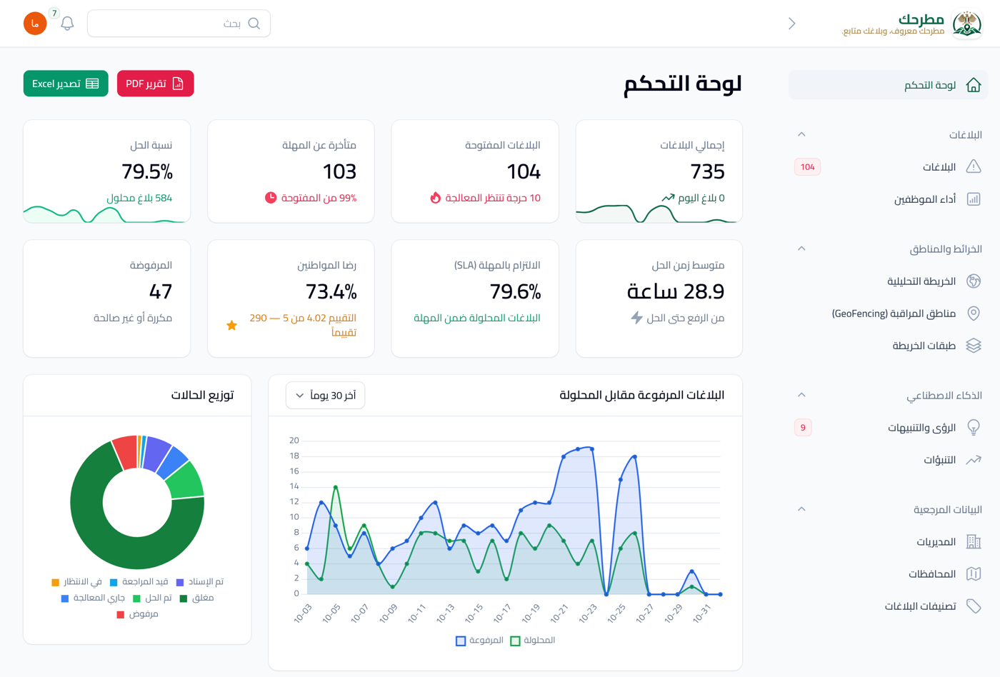
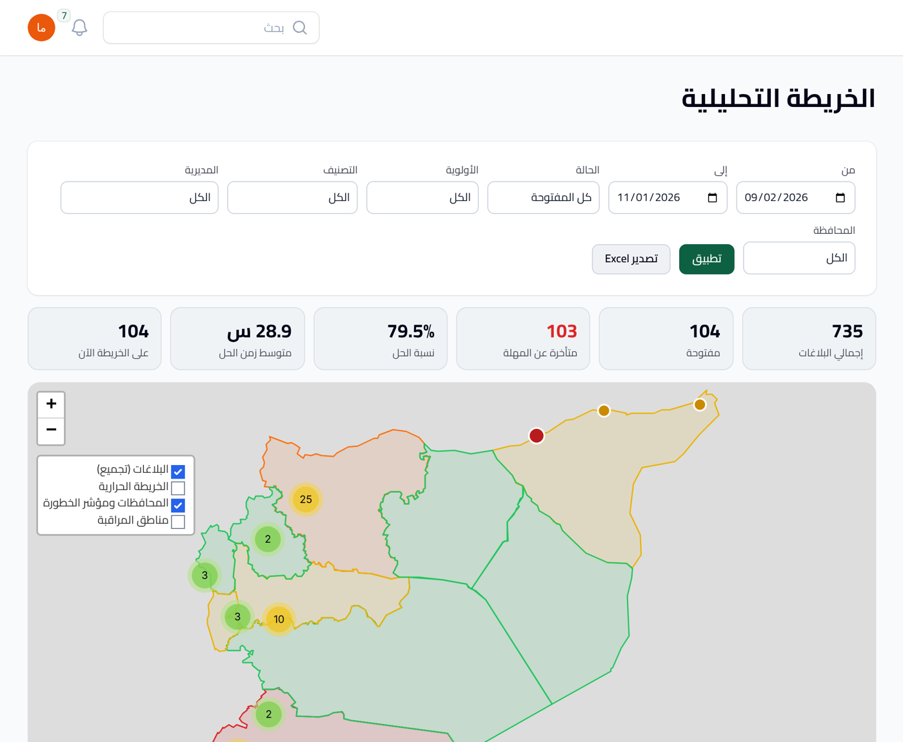
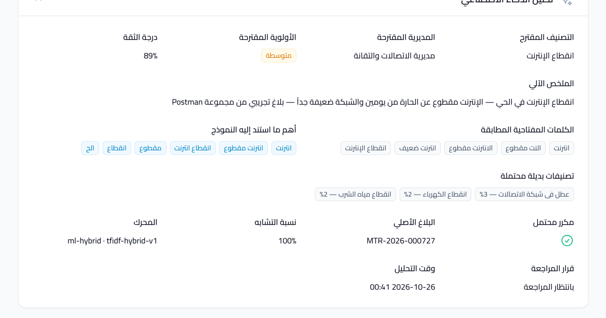
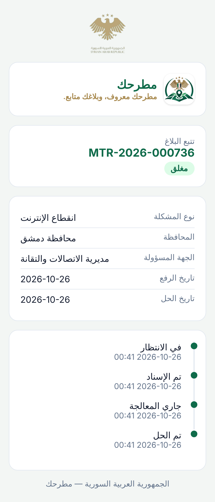
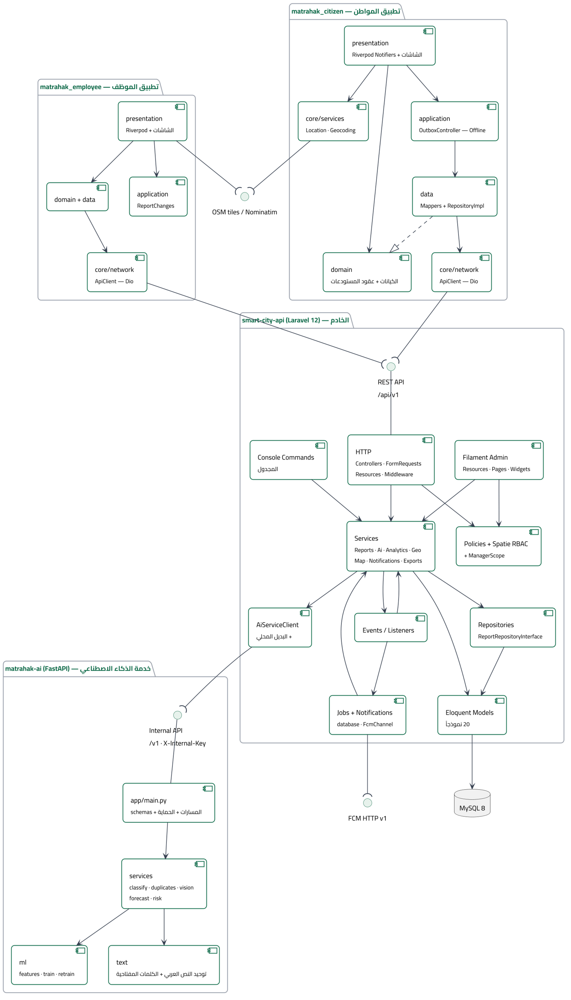

<div align="center">

# مطرحك · Matrahak

### An intelligent platform for managing citizen reports using AI and GIS

**منصة ذكية لإدارة بلاغات المواطنين باستخدام الذكاء الاصطناعي ونظم المعلومات الجغرافية**

*"مطرحك معروف، وبلاغك متابع."*


-red)

</div>

---

## Overview

**Matrahak** turns the handling of citizen reports — potholes, outages, leaks, waste — from
scattered phone calls and paper forms into a single, traceable, measurable workflow. A citizen
files a geo-located report in seconds; AI classifies it, estimates priority, detects duplicates and
routes it to the right department and the least-busy field worker; the city watches everything live
on an analytical digital-twin map, backed by performance indicators and predictive analytics.

It is built entirely on **open-source, self-hostable technology** that runs without paid map keys or
Google services — a deliberate fit for the Syrian environment. If the AI service goes down, an
identical local fallback keeps the platform running.

> Graduation project — Informatics Engineering, Al-Jazeera Private University (2025–2026).
>
> **Source-available, not open-source** — you are welcome to read and study this code, but
> commercial use, redistribution and removing the authorship notices are not permitted.
> See [License & usage](#license--usage).

<div align="center">

| | |
|:---:|:---:|
|  |  |
| **Admin dashboard** — live city indicators | **Analytical map** — the city's digital twin |
|  |  |
| **Explainable AI** — classification with reasoning | **Public tracking page** — opened by a QR code |

</div>

## Key features

**For citizens** (`matrahak_citizen` — Flutter)
- File a report with up to 5 photos/video, pinpoint location from GPS or the map, with automatic reverse-geocoding.
- Offline outbox: reports are saved on-device when there's no connection and sent automatically later.
- Track each report through an explicit lifecycle, see official replies and before/after photos, and rate the service.
- In-app notifications without Google services (45-second polling; FCM optional).
- Upvote nearby reports instead of filing duplicates; a shareable QR tracking page reveals no personal data.

**For field workers** (`matrahak_employee` — Flutter)
- Receive auto-assigned reports (governorate-first, least-loaded), or claim from the department pool.
- A **state machine** that only ever offers valid transitions; three guard layers before any change.
- Add internal notes or public replies, document work with before/after photos, transfer across departments.
- Department map with "nearest report to me", plus personal and department performance stats.

**For the administration** (`smart-city-api` — Laravel + Filament)
- Live dashboard, report management, role-scoped access (a governorate manager sees only their governorate).
- **Digital-twin analytical map**: clustering, heatmap, risk-scored boundaries, geofencing, time-replay.
- Audit log for every administrative action; PDF & Excel reports.

**AI service** (`matrahak-ai` — FastAPI + scikit-learn)
- Arabic report classification (TF-IDF over word stems + character n-grams, LinearSVC) — **91.7%** on a dialect stress test.
- Priority estimation, duplicate detection, image tagging, Poisson-EWMA forecasting, per-governorate risk scoring.
- Stateless, internal-key protected; retrains from human-confirmed reports with a Champion/Challenger McNemar gate.

## Architecture

Four independent parts around a central Laravel server. Only the server reaches the database, and
only the server calls the AI service (with an internal key). Every external dependency is optional.



## Repository structure

| Folder | Part | Stack |
|---|---|---|
| [`smart-city-api/`](smart-city-api) | Backend API & admin panel | Laravel 12, Filament 3.3, Sanctum, Spatie Permission, MySQL 8 |
| [`matrahak-ai/`](matrahak-ai) | AI microservice | Python 3.13, FastAPI, scikit-learn, NumPy/SciPy |
| [`matrahak_citizen/`](matrahak_citizen) | Citizen mobile app | Flutter 3.35, Riverpod 3, GoRouter, flutter_map |
| [`matrahak_employee/`](matrahak_employee) | Field-worker mobile app | Flutter 3.35, Riverpod 3 |
| [`matrahak-docs/`](matrahak-docs) | API reference, UML/ERD diagrams, Postman collection | — |

## Getting started

Full setup is in [`matrahak-docs/02-windows-setup.md`](matrahak-docs/02-windows-setup.md). In short:

```bash
# 1) Backend + admin panel
cd smart-city-api
composer install && cp .env.example .env
php artisan key:generate && php artisan storage:link
php artisan migrate:fresh --seed
php artisan serve --host=0.0.0.0 --port=8000     # admin at /admin

# 2) AI service
cd ../matrahak-ai && ./run.sh                     # http://127.0.0.1:8001

# 3) Mobile apps
cd ../matrahak_citizen && flutter run
```

Demo accounts (seeded — **change the passwords before any public deployment**):
`admin@matrahak.sy` / `Admin@1234` · `citizen@matrahak.sy` / `Citizen@1234` · `employee.telecom@matrahak.sy` / `Employee@1234`

## Testing

Everything was tested on a real server and a real MySQL database — not mock data.

| Suite | Result |
|---|---|
| Backend (PHPUnit) | **103 tests, 832 assertions** passing |
| AI service (pytest) | **43 tests** passing |
| Mobile apps (Flutter) | **57 unit tests**; `dart analyze` clean; data layer 30/30 & 29/29 on the live server |
| API scenario (Postman/Newman) | **226 assertions**, 0 failures |
| Requirements traceability | **219 items** matched (90.4% as specified) |

## Tech stack

`PHP 8.3` · `Laravel 12` · `Filament 3.3` · `Laravel Sanctum` · `Spatie Permission` · `MySQL 8` ·
`Python 3.13` · `FastAPI` · `scikit-learn` · `Flutter 3.35` · `Dart` · `Riverpod 3` · `GoRouter` ·
`OpenStreetMap` · `Leaflet` · `flutter_map` · `Nominatim`

## Author

**Eng. Tareq Bassam Bakr** (م. طارق بسام بكر) — Informatics Engineering · GitHub [@abotrek18-boop](https://github.com/abotrek18-boop)
Supervised by **Dr. Adnan Ali** — Al-Jazeera Private University, 2025–2026.

## License & usage

**© 2026 Tareq Bassam Bakr — All rights reserved.** This repository is *source-available*, not
open-source. See [LICENSE](LICENSE) for the full terms.

| | |
|---|---|
| **You may** | view, read and study the code; clone one copy for personal study or to evaluate my work; quote short excerpts with credit |
| **You may not** | use it commercially · deploy or host it (free or paid) · redistribute or sell it · build derivative works · **remove the authorship notices** · present it as your own work |

Every source file carries a copyright header, and the attribution
*"Developed by Eng. Tareq Bassam Bakr — طُوّر بواسطة م. طارق بسام بكر"* is displayed in the admin
panel footer, the public tracking page, the generated PDF reports and both mobile apps.
Removing it is a breach of the license.

For commercial licensing or deployment permission, reach me through this GitHub profile.

> **Note:** the Syrian state emblem that appears in the admin panel, the tracking page and the PDF
> report is used here for an academic demonstration. Its use is legally restricted to official
> bodies; for any public deployment, obtain the relevant authorization or set `BRAND_STATE_EMBLEM=false`.
