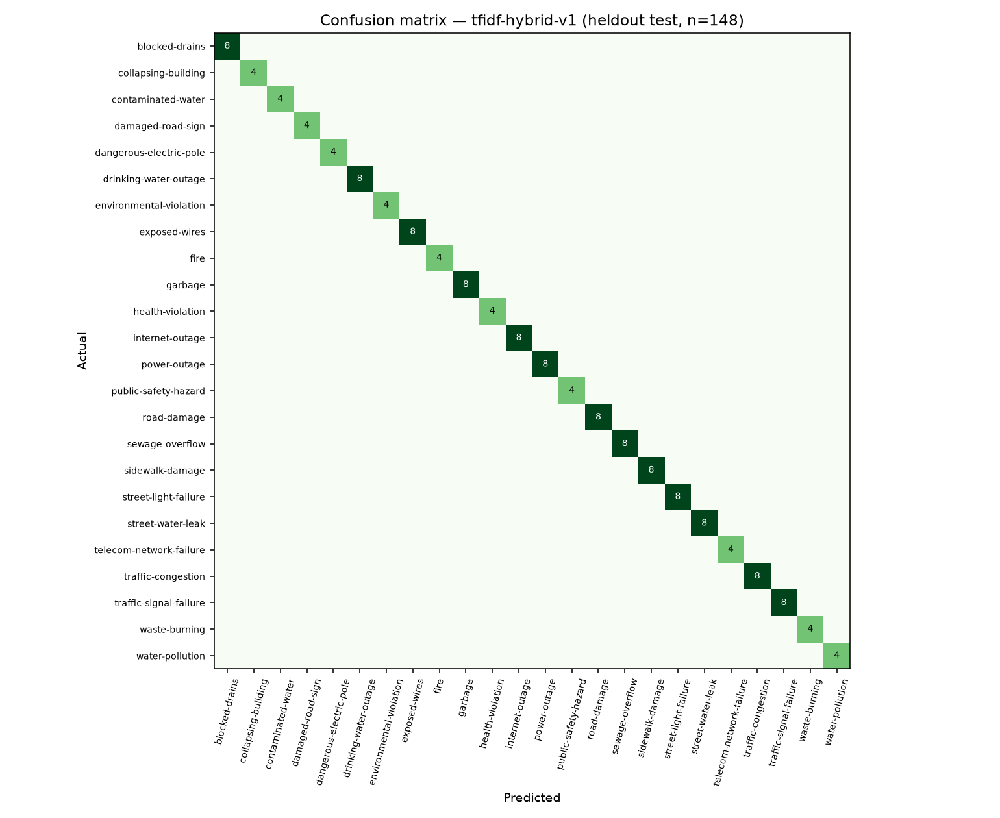

# تقرير تقييم نموذج تصنيف البلاغات — مطرحك

- **النموذج:** `tfidf-hybrid-v1` — TF-IDF (جذور الكلمات unigram/bigram + مقاطع الحروف 2–5) + LinearSVC (معايرة Platt) C=0.5 — مختار عبر Grouped CV
- **تاريخ التقييم:** 2026-10-23T04:25:01
- **بيانات التدريب:** 1917 عينة — المصادر: {'synthetic': 1917}
- **Decontamination:** عدد العينات المستبعدة من التدريب لأنها شبه مطابقة (cosine ≥ 0.8) لعينات الاختبار: المولّدة 3، الحقيقية 0 — حتى لا يتدرّب النموذج على أسئلة الامتحان.
- **بيانات الاختبار:** 148 عينة — مجموعة اختبار مستقلة مكتوبة يدوياً (غير مستخدمة في التدريب) — ليست بلاغات حقيقية

## النتائج

| المقياس | القيمة |
|---|---|
| Accuracy على الاختبار | 100.0% |
| Macro F1 على الاختبار | 100.0% |
| Grouped Cross-Validation Accuracy (5 طيات) | 99.4% ± 0.4% |
| Grouped Cross-Validation Macro F1 | 99.5% |
| اختبار الإجهاد Accuracy (48 نصاً قصيراً/عامياً) | 91.7% |
| اختبار الإجهاد Macro F1 | 91.5% |
| **الهجين المعتمد في الخدمة** — Accuracy على الاختبار | 100.0% |
| **الهجين المعتمد في الخدمة** — Accuracy على الإجهاد | 89.6% |

> **Grouped CV:** كل قالب جملة في بيانات التدريب المولّدة يُعامل كمجموعة واحدة، فلا تظهر الجملة نفسها
> في التدريب والتحقق معاً — بدون ذلك تصل الدقة إلى ~100% بشكل مضلل.
> **اختبار الإجهاد:** نصوص قصيرة جداً، أخطاء إملائية، ومرادفات عامية لم ترد في التدريب (data/challenge_test.csv).

## اختيار النموذج (Grouped Cross-Validation فقط)

| المصنّف | C | CV Accuracy | CV Macro F1 |
|---|---|---|---|
| LogReg | 2.0 | 98.8% ± 0.5% | 98.8% |
| LogReg | 8.0 | 99.1% ± 0.5% | 99.0% |
| LogReg | 32.0 | 98.9% ± 0.7% | 98.9% |
| LinearSVC | 0.25 | 99.2% ± 0.4% | 99.2% |
| LinearSVC | 0.5 | 99.4% ± 0.4% | 99.5% |
| LinearSVC | 1.0 | 99.4% ± 0.5% | 99.5% |

## اختيار وزن الكلمات المفتاحية في الهجين (Grouped CV — احتمالات Out-of-fold)

| الوزن w | CV Accuracy | CV Macro F1 |
|---|---|---|
| 0.0 | 99.4% | 99.4% |
| 0.1 | 99.6% | 99.6% |
| 0.2 | 99.5% | 99.5% |
| 0.3 ✅ | 99.7% | 99.7% |

> عند التعادل يُختار الوزن التصميمي 0.2 إن كان ضمن الأفضل، وإلا الأصغر.

## مقارنة النماذج

| النموذج | Accuracy (الاختبار) | Macro F1 (الاختبار) | Accuracy (الإجهاد) | Macro F1 (الإجهاد) |
|---|---|---|---|---|
| keywords-only (معرفة الخبير) | 98.7% | 98.4% | 68.8% | 69.5% |
| TF-IDF words + LogReg | 100.0% | 100.0% | 77.1% | 73.9% |
| TF-IDF chars + LogReg | 100.0% | 100.0% | 87.5% | 87.9% |
| TF-IDF words+chars + LinearSVC C=0.5 (tfidf-hybrid-v1 — المختار) | 100.0% | 100.0% | 91.7% | 91.5% |
| الهجين المعتمد في الخدمة: النموذج المختار 70% + الكلمات المفتاحية 30% | 100.0% | 100.0% | 89.6% | 89.3% |

> «keywords-only» هو نفسه البديل المحلي في Laravel حرفياً (نفس التصنيف ونفس درجة الثقة — tests/test_arabic.py)،
> أي أن هذا السطر هو أداء المنصة عند توقف خدمة الذكاء الاصطناعي.
> ملاحظة: قوائم الكلمات المفتاحية ضُبطت جزئياً على قوالب مجموعة الاختبار، لذلك نتيجة «keywords-only» والهجين على
> الاختبار متفائلة؛ اختبار الإجهاد هو المقارنة الأعدل. وزن الكلمات المفتاحية في الهجين اختير عبر
> Grouped CV على بيانات التدريب ولم يُضبط على أي من مجموعتي الاختبار.

## الأداء لكل تصنيف

| التصنيف | Precision | Recall | F1 | العدد |
|---|---|---|---|---|
| blocked-drains | 1.00 | 1.00 | 1.00 | 8 |
| collapsing-building | 1.00 | 1.00 | 1.00 | 4 |
| contaminated-water | 1.00 | 1.00 | 1.00 | 4 |
| damaged-road-sign | 1.00 | 1.00 | 1.00 | 4 |
| dangerous-electric-pole | 1.00 | 1.00 | 1.00 | 4 |
| drinking-water-outage | 1.00 | 1.00 | 1.00 | 8 |
| environmental-violation | 1.00 | 1.00 | 1.00 | 4 |
| exposed-wires | 1.00 | 1.00 | 1.00 | 8 |
| fire | 1.00 | 1.00 | 1.00 | 4 |
| garbage | 1.00 | 1.00 | 1.00 | 8 |
| health-violation | 1.00 | 1.00 | 1.00 | 4 |
| internet-outage | 1.00 | 1.00 | 1.00 | 8 |
| power-outage | 1.00 | 1.00 | 1.00 | 8 |
| public-safety-hazard | 1.00 | 1.00 | 1.00 | 4 |
| road-damage | 1.00 | 1.00 | 1.00 | 8 |
| sewage-overflow | 1.00 | 1.00 | 1.00 | 8 |
| sidewalk-damage | 1.00 | 1.00 | 1.00 | 8 |
| street-light-failure | 1.00 | 1.00 | 1.00 | 8 |
| street-water-leak | 1.00 | 1.00 | 1.00 | 8 |
| telecom-network-failure | 1.00 | 1.00 | 1.00 | 4 |
| traffic-congestion | 1.00 | 1.00 | 1.00 | 8 |
| traffic-signal-failure | 1.00 | 1.00 | 1.00 | 8 |
| waste-burning | 1.00 | 1.00 | 1.00 | 4 |
| water-pollution | 1.00 | 1.00 | 1.00 | 4 |

## مصفوفة الالتباس (Confusion Matrix)

## أخطاء النموذج المختار (4)

- [إجهاد] «ما في ضو بالبيت من امبارح» — المتوقع `power-outage`، تنبأ `collapsing-building`
- [إجهاد] «اللمبة اللي عالعمود محروقة» — المتوقع `street-light-failure`، تنبأ `dangerous-electric-pole`
- [إجهاد] «العامود رح يوقع على البيت» — المتوقع `dangerous-electric-pole`، تنبأ `collapsing-building`
- [إجهاد] «الريغار فايض» — المتوقع `sewage-overflow`، تنبأ `public-safety-hazard`

## أخطاء الهجين المعتمد في الخدمة (5)

- [إجهاد] «ما في ضو بالبيت من امبارح» — المتوقع `power-outage`، تنبأ `street-light-failure`
- [إجهاد] «اللمبة اللي عالعمود محروقة» — المتوقع `street-light-failure`، تنبأ `dangerous-electric-pole`
- [إجهاد] «العامود رح يوقع على البيت» — المتوقع `dangerous-electric-pole`، تنبأ `collapsing-building`
- [إجهاد] «الريغار فايض» — المتوقع `sewage-overflow`، تنبأ `public-safety-hazard`
- [إجهاد] «الحيط رح يوقع عالطريق» — المتوقع `collapsing-building`، تنبأ `road-damage`

## حدود التقييم

- بيانات التدريب الأولية **مولّدة** (scripts/generate_synthetic.py) لتشغيل المنصة من اليوم الأول.
- مجموعة الاختبار المستقلة مكتوبة يدوياً بصياغات مختلفة، لكنها ليست بلاغات مواطنين حقيقيين؛
  لذلك الدقة أعلاه **ليست** دقة العالم الحقيقي.
- مجموعتا الاختبار صغيرتان (148 و48 نصاً): عينة واحدة في اختبار الإجهاد ≈ 2 نقطة مئوية، فالفروق الصغيرة
  بين النماذج (مثل الهجين مقابل النموذج وحده) ضمن هامش الضجيج الإحصائي.
- الدقة الحقيقية تُقاس بعد التجربة الميدانية: زر «إعادة تدريب النموذج» في لوحة الإدارة يرسل البلاغات
  الموثّقة ويقارن النموذج الجديد بالحالي على 20% منها لم يرها (Champion/Challenger + اختبار McNemar)،
  ويحفظها في `data/real/` — بعدها يعيد هذا السكربت التقييم الكامل على 30% من البلاغات الحقيقية
  (أو صدّرها يدوياً: `php artisan ai:export-training-data` ثم ضع الملف في `data/real/`).
- كشف التكرار وتحليل الصور استدلاليان (Heuristic) وغير مُقيَّمين على بيانات حقيقية — انظر README.
