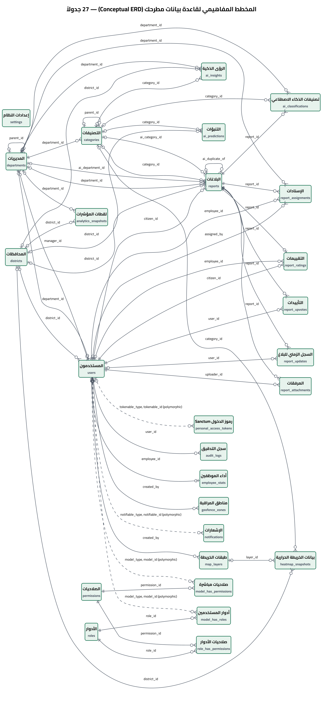
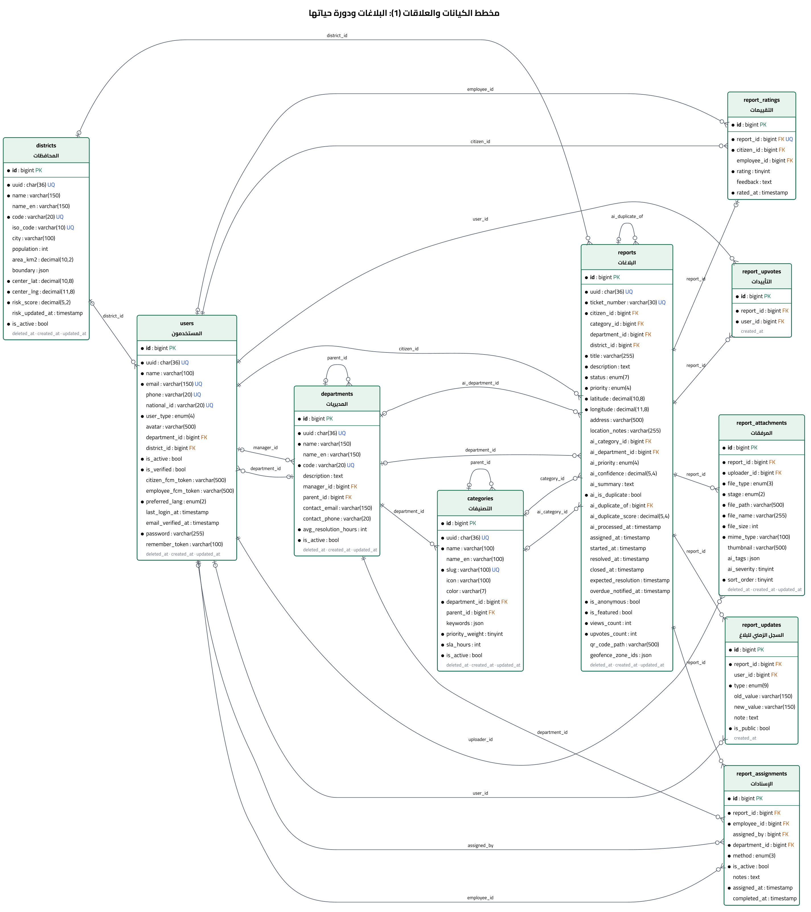
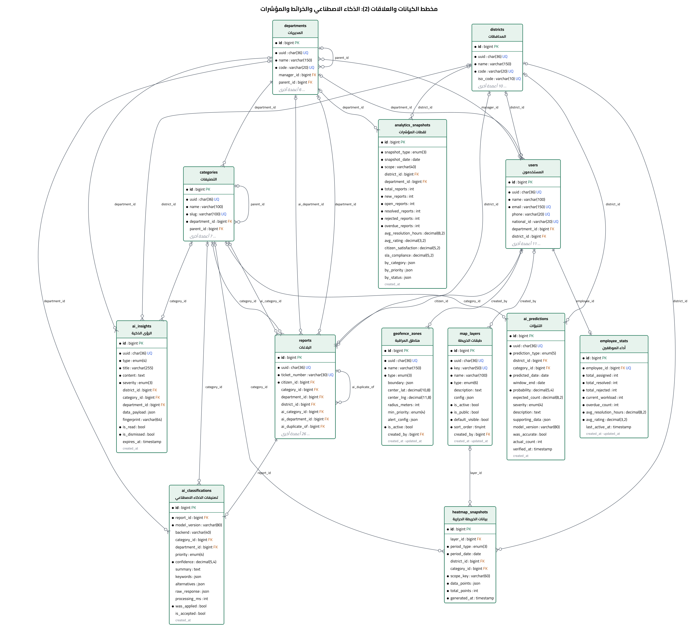
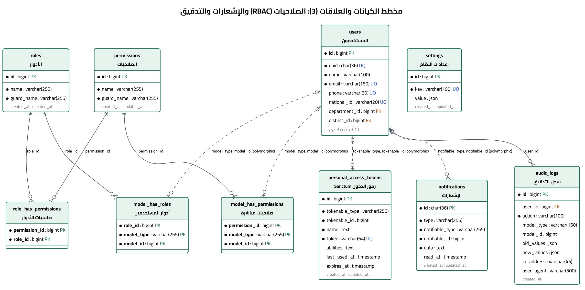

# تصميم قاعدة البيانات — منصة «مطرحك»

كل ما في هذا الملف مستخرج من قاعدة البيانات **الفعلية**، لا من تصميم نظري.
- **المصدر:** `information_schema` في MySQL 8.4، بعد `php artisan migrate:fresh --seed` وبيانات العرض.
- **قاموس البيانات الكامل:** 35 جدولاً و367 عموداً، في الملف [`04b-data-dictionary.md`](04b-data-dictionary.md).

| البند | القيمة |
|---|---|
| المحرك | MySQL 8 أو MariaDB 10.6+ — InnoDB |
| الترميز | `utf8mb4` · `utf8mb4_unicode_ci`، ويدعم العربية والرموز كاملةً |
| الجداول | 35 جدولاً: **27 جدول نطاق** + 8 جداول إطار عمل (الكاش، الجلسات، الطابور، الترحيلات) |
| المفاتيح الأجنبية | 47: SET NULL (29)، CASCADE (12)، RESTRICT (6) |
| الفهارس غير الأساسية | 108: منها 19 مركّباً، و23 فريداً، وفهرس FULLTEXT |
| الترحيلات | 26 — `database/migrations` |
| قيود التحقق | Enum للحالة والأولوية ونوع المستخدم، وقيود فريدة، ومعاملات (Transactions) في الخدمات |

---

## 1. المخطط المفاهيمي (Conceptual ERD)

كل جداول النطاق الـ 27 والعلاقات بينها، بترميز Crow's Foot.
**قراءة الرموز:**
- `||` واحد إلزامي، و`|o` صفر أو واحد.
- `o{` صفر أو أكثر.
- الخط المتقطع علاقة متعددة الأشكال (Polymorphic) بلا مفتاح أجنبي في MySQL.

---

## 2. المخططات التفصيلية (Logical ERD)

### 2.1 البلاغات ودورة حياتها
البلاغ هو الكيان المركزي. حوله: المرفقات، والسجل الزمني، والإسنادات، والتقييم، والتأييدات.
وهو مرتبط بالمواطن والتصنيف والمديرية والمحافظة.

### 2.2 الذكاء الاصطناعي والخرائط والمؤشرات
جداول التحليل: التصنيف الآلي، والتنبؤات، والرؤى. وجداول الخرائط: الطبقات، والخريطة الحرارية، ومناطق المراقبة.
وجداول الأداء: لقطات المؤشرات، وأداء الموظفين.
الجداول المرجعية تظهر مختصرة (المفاتيح فقط).

### 2.3 الصلاحيات (RBAC) والإشعارات والتدقيق
جداول Spatie Permission، ورموز Sanctum، والإشعارات، وسجل التدقيق، والإعدادات.

---

## 3. الكيانات الرئيسية

| الجدول | الغرض | أهم القرارات |
|---|---|---|
| `users` | كل الحسابات في جدول واحد، و`user_type` يحدد النوع | `email` و`phone` و`national_id` فريدة. الدور (Role) يُزامَن تلقائياً مع `user_type`. رمز FCM منفصل لكل تطبيق |
| `departments` | 8 مديريات: الخدمات، الكهرباء، المياه، السير، البيئة، الدفاع المدني، الاتصالات، الصحة | `code` ثابت وفريد، تستخدمه خدمة الذكاء الاصطناعي. `parent_id` لهيكل هرمي |
| `districts` | المحافظات السورية الـ 14 | `boundary` بصيغة GeoJSON من حدود OCHA لتحديد محافظة البلاغ (Point-in-Polygon). `population` لحساب المؤشرات لكل 100 ألف نسمة. `risk_score` يُحدَّث يومياً |
| `categories` | 24 تصنيفاً، كل منها يتبع مديرية | `keywords` (JSON) معرفة الخبير للتصنيف الآلي. `priority_weight` من 1 إلى 10، و`sla_hours` مهلة الحل |
| `reports` | البلاغ | معرّف داخلي `id` للعلاقات، و`uuid` للروابط العامة، و`ticket_number` للمواطن. أعمدة `ai_*` تحفظ آخر اقتراح آلي للفلترة السريعة |
| `report_updates` | السجل الزمني | سطر لكل حدث (9 أنواع)، و`is_public` يفصل ما يراه المواطن عن الملاحظات الداخلية |
| `report_assignments` | تاريخ الإسناد كاملاً | سطر فعّال واحد لكل بلاغ (`is_active`)، والأسطر السابقة تبقى للتاريخ. `method`: تلقائي أو يدوي أو استلام |
| `report_ratings` | تقييم المواطن | قيد فريد على `report_id`: تقييم واحد لكل بلاغ. `employee_id` يُحفظ وقت التقييم |
| `report_upvotes` | التأييد | قيد فريد على (`report_id`, `user_id`): تأييد واحد لكل مستخدم |
| `ai_classifications` | كل محاولة تصنيف | الثقة، والكلمات المطابقة، والبدائل، و`raw_response`، وقرار الإدارة `is_accepted`. منها تُبنى بيانات إعادة التدريب |
| `ai_predictions` | التنبؤات | `predicted_date` و`window_end` نافذة التنبؤ. `was_accurate` و`actual_count` تُحسب بعد انتهاء النافذة |
| `geofence_zones` | مناطق المراقبة | مضلّع (`boundary`) **أو** دائرة (`center` + `radius_meters`)، و`min_priority` يرفع أولوية البلاغ داخلها |
| `audit_logs` | سجل التدقيق | `model_type` + `model_id` (Polymorphic)، والقيم السابقة والجديدة، والمستخدم، و IP، والجهاز. للقراءة فقط |

---

## 4. تحليل التطبيع (Normalization Analysis)

### 4.1 الصيغة الأولى (1NF): قيم ذرّية، ولا مجموعات متكررة
- كل الأعمدة العلائقية ذرّية.
- المرفقات والإسنادات والتقييمات والتأييدات والسجل الزمني في جداول مستقلة، وليست أعمدة متكررة مثل `image1` و`image2`.
- **أعمدة JSON** موجودة عن قصد، وكلها وثائق تُقرأ وتُكتب كاملةً ولا يُستعلم داخلها علائقياً:
  - `categories.keywords`
  - `districts.boundary` و`geofence_zones.boundary`
  - `map_layers.config`
  - `heatmap_snapshots.data_points`
  - `analytics_snapshots.by_*`
  - `ai_classifications.keywords/alternatives/raw_response`
  - `audit_logs.old_values/new_values`
  - `report_attachments.ai_tags`

  فالقيمة الذرّية فيها هي الوثيقة نفسها، كالمضلع الجغرافي الواحد.
- **الاستثناء المقصود الوحيد:** `reports.geofence_zone_ids`. انظر 4.5.

### 4.2 الصيغة الثانية (2NF): لا اعتماد جزئي على المفتاح
- كل جداول النطاق لها مفتاح بديل (Surrogate Key) من عمود واحد `id`، فلا يوجد اعتماد جزئي أصلاً.
- الجداول ذات المفتاح المركّب هي الجداول الوسيطة فقط: `role_has_permissions` و`model_has_roles` و`model_has_permissions`.
  ولا تحوي أي عمود غير مفتاحي.

### 4.3 الصيغة الثالثة (3NF): لا اعتماد متعدٍّ
- اسم المديرية واسم التصنيف واسم المحافظة لا تتكرر في `reports`، بل مفاتيح أجنبية فقط.
- **`reports.department_id` ليس تكراراً لـ `categories.department_id`.** هو «المديرية التي تعالج البلاغ الآن»، وقد تختلف عن مديرية التصنيف:
  - بلاغ بلا تصنيف حُوّل يدوياً.
  - أو تحويل يُفرّغ التصنيف القديم.

  فهو حقيقة مستقلة، وليس مشتقاً من التصنيف.
- **`reports.district_id`** يُشتق من الإحداثيات مرة واحدة عند الرفع، ويُخزَّن لأنه:
  1. يحفظ المحافظة حسب الحدود **وقت** الرفع.
  2. يُفهرس مع الحالة `(district_id, status)` لنطاق مدير المحافظة.

  حسابه من المضلع في كل استعلام غير ممكن عملياً.

### 4.4 صيغة Boyce-Codd (BCNF)
- كل محدِّد (Determinant) في الجداول مفتاح مرشّح (Candidate Key)، وعليه قيد فريد.
- المفاتيح المرشّحة: `uuid` و`ticket_number` و`email` و`phone` و`national_id` و`slug` و`code` و`key`.
- القيود الفريدة المركّبة تمثّل قواعد الأعمال نفسها:
  - تأييد واحد لكل مستخدم: `(report_id, user_id)`.
  - لقطة واحدة لكل نطاق وتاريخ: `(snapshot_type, snapshot_date, scope)`.

### 4.5 إلغاء التطبيع المقصود (Denormalization) ومبرراته

| الحقل أو الجدول | ما يكرّره | لماذا | كيف تُضمن الصحة |
|---|---|---|---|
| `reports.ai_category_id` و`ai_priority` و`ai_confidence` و`ai_summary` | آخر سطر في `ai_classifications` | قوائم الإدارة تُفلتر وتُرتّب بالاقتراح الآلي والثقة دون JOIN على تاريخ التصنيفات | تُكتب في نفس عملية التصنيف (`ReportAiProcessor`)، والتاريخ الكامل يبقى في `ai_classifications` |
| `reports.upvotes_count` و`views_count` | عدد صفوف `report_upvotes` | الترتيب حسب الأكثر تأييداً على الخريطة | التأييد وإلغاؤه يحدّثان العداد في المعاملة نفسها، والقيد الفريد يمنع التكرار |
| `reports.geofence_zone_ids` (JSON) | علاقة متعدد–متعدد مع `geofence_zones` | لقطة للمناطق **وقت** الرفع، تُكتب مرة ولا تتغير، ونادراً ما يُستعلم عنها (عدّاد في صفحة المناطق عبر `JSON_CONTAINS`) | عند كثرة المناطق: جدول وسيط `report_geofence_zone` |
| `employee_stats` | تجميعات من `report_assignments` و`reports` و`report_ratings` | لوحة الأداء وتطبيق الموظف يقرآنها مباشرةً | **يُعاد حسابه بالكامل** من الجداول الأصلية بعد كل إسناد وتغيير حالة وتحويل وتقييم (`RefreshEmployeeStats`)، لا عدّادات تتراكم وتنحرف |
| `analytics_snapshots` و`heatmap_snapshots` | تجميعات من `reports` | سلسلة زمنية تاريخية: قيمة المؤشر **في يوم** مضى لا يمكن استرجاعها لاحقاً من البيانات الحالية | يكتبها المجدول بقيد فريد لكل (نوع، تاريخ، نطاق)، وإعادة التشغيل تستبدل اللقطة |

---

## 5. المفاتيح الأجنبية وقواعد الحذف

**القاعدة العامة:**
- **CASCADE** لما لا معنى له دون أصله: المرفق والسجل والإسناد والتقييم مع البلاغ.
- **RESTRICT** لما يحمي سجلاً تاريخياً: لا يُحذف مواطن له بلاغات، ولا موظف له إسنادات.
- **SET NULL** للمراجع الاختيارية: حذف تصنيف لا يحذف بلاغاته.
- البلاغات والمستخدمون والتصنيفات والمديريات والمحافظات والمرفقات تستخدم **Soft Delete** (`deleted_at`)، فالحذف من الواجهة لا يكسر هذه القيود أصلاً.

| الجدول التابع | العمود | يشير إلى | عند حذف الأصل | NULL؟ |
|---|---|---|---|---|
| `ai_classifications` | `category_id` | `categories.id` | SET NULL — يبقى ويُفرَّغ الحقل | نعم |
| `ai_classifications` | `department_id` | `departments.id` | SET NULL — يبقى ويُفرَّغ الحقل | نعم |
| `ai_classifications` | `report_id` | `reports.id` | CASCADE — يُحذف معه | لا |
| `ai_insights` | `category_id` | `categories.id` | SET NULL — يبقى ويُفرَّغ الحقل | نعم |
| `ai_insights` | `department_id` | `departments.id` | SET NULL — يبقى ويُفرَّغ الحقل | نعم |
| `ai_insights` | `district_id` | `districts.id` | SET NULL — يبقى ويُفرَّغ الحقل | نعم |
| `ai_predictions` | `category_id` | `categories.id` | SET NULL — يبقى ويُفرَّغ الحقل | نعم |
| `ai_predictions` | `district_id` | `districts.id` | SET NULL — يبقى ويُفرَّغ الحقل | نعم |
| `analytics_snapshots` | `department_id` | `departments.id` | SET NULL — يبقى ويُفرَّغ الحقل | نعم |
| `analytics_snapshots` | `district_id` | `districts.id` | SET NULL — يبقى ويُفرَّغ الحقل | نعم |
| `audit_logs` | `user_id` | `users.id` | SET NULL — يبقى ويُفرَّغ الحقل | نعم |
| `categories` | `department_id` | `departments.id` | RESTRICT — يمنع الحذف | لا |
| `categories` | `parent_id` | `categories.id` | SET NULL — يبقى ويُفرَّغ الحقل | نعم |
| `departments` | `manager_id` | `users.id` | SET NULL — يبقى ويُفرَّغ الحقل | نعم |
| `departments` | `parent_id` | `departments.id` | SET NULL — يبقى ويُفرَّغ الحقل | نعم |
| `employee_stats` | `employee_id` | `users.id` | CASCADE — يُحذف معه | لا |
| `geofence_zones` | `created_by` | `users.id` | SET NULL — يبقى ويُفرَّغ الحقل | نعم |
| `heatmap_snapshots` | `category_id` | `categories.id` | SET NULL — يبقى ويُفرَّغ الحقل | نعم |
| `heatmap_snapshots` | `district_id` | `districts.id` | SET NULL — يبقى ويُفرَّغ الحقل | نعم |
| `heatmap_snapshots` | `layer_id` | `map_layers.id` | SET NULL — يبقى ويُفرَّغ الحقل | نعم |
| `map_layers` | `created_by` | `users.id` | SET NULL — يبقى ويُفرَّغ الحقل | نعم |
| `model_has_permissions` | `permission_id` | `permissions.id` | CASCADE — يُحذف معه | لا |
| `model_has_roles` | `role_id` | `roles.id` | CASCADE — يُحذف معه | لا |
| `report_assignments` | `assigned_by` | `users.id` | SET NULL — يبقى ويُفرَّغ الحقل | نعم |
| `report_assignments` | `department_id` | `departments.id` | RESTRICT — يمنع الحذف | لا |
| `report_assignments` | `employee_id` | `users.id` | RESTRICT — يمنع الحذف | لا |
| `report_assignments` | `report_id` | `reports.id` | CASCADE — يُحذف معه | لا |
| `report_attachments` | `report_id` | `reports.id` | CASCADE — يُحذف معه | لا |
| `report_attachments` | `uploader_id` | `users.id` | RESTRICT — يمنع الحذف | لا |
| `report_ratings` | `citizen_id` | `users.id` | RESTRICT — يمنع الحذف | لا |
| `report_ratings` | `employee_id` | `users.id` | SET NULL — يبقى ويُفرَّغ الحقل | نعم |
| `report_ratings` | `report_id` | `reports.id` | CASCADE — يُحذف معه | لا |
| `report_updates` | `report_id` | `reports.id` | CASCADE — يُحذف معه | لا |
| `report_updates` | `user_id` | `users.id` | SET NULL — يبقى ويُفرَّغ الحقل | نعم |
| `report_upvotes` | `report_id` | `reports.id` | CASCADE — يُحذف معه | لا |
| `report_upvotes` | `user_id` | `users.id` | CASCADE — يُحذف معه | لا |
| `reports` | `ai_category_id` | `categories.id` | SET NULL — يبقى ويُفرَّغ الحقل | نعم |
| `reports` | `ai_department_id` | `departments.id` | SET NULL — يبقى ويُفرَّغ الحقل | نعم |
| `reports` | `ai_duplicate_of` | `reports.id` | SET NULL — يبقى ويُفرَّغ الحقل | نعم |
| `reports` | `category_id` | `categories.id` | SET NULL — يبقى ويُفرَّغ الحقل | نعم |
| `reports` | `citizen_id` | `users.id` | RESTRICT — يمنع الحذف | لا |
| `reports` | `department_id` | `departments.id` | SET NULL — يبقى ويُفرَّغ الحقل | نعم |
| `reports` | `district_id` | `districts.id` | SET NULL — يبقى ويُفرَّغ الحقل | نعم |
| `role_has_permissions` | `permission_id` | `permissions.id` | CASCADE — يُحذف معه | لا |
| `role_has_permissions` | `role_id` | `roles.id` | CASCADE — يُحذف معه | لا |
| `users` | `department_id` | `departments.id` | SET NULL — يبقى ويُفرَّغ الحقل | نعم |
| `users` | `district_id` | `districts.id` | SET NULL — يبقى ويُفرَّغ الحقل | نعم |

---

## 6. الفهارس وما تخدمه

| الفهرس | الاستعلام الذي يخدمه |
|---|---|
| `reports (latitude, longitude)` | البلاغات القريبة: Bounding Box ثم مسافة Haversine (`Report::scopeNearby`) |
| `reports (status, department_id, created_at)` | قوائم الإدارة والتحليلات حسب الحالة والمديرية والتاريخ |
| `reports (district_id, status)` | نطاق مدير المحافظة: كل عدّادات لوحته ومؤشراته |
| `reports (expected_resolution)` | البلاغات المتأخرة (`reports:check-overdue`، ومؤشر SLA) |
| `reports (priority)` · `(status)` · `(created_at)` | الفلاتر والترتيب والسلاسل اليومية للتنبؤ |
| `reports ticket_number` · `uuid` (فريدان) | البحث برقم المتابعة، والروابط العامة `/track/{uuid}` |
| `report_assignments (employee_id, is_active)` | «البلاغات المسندة إليّ» وعبء العمل لاختيار الموظف الأقل عبئاً |
| `report_assignments (report_id, is_active)` | الإسناد الفعّال للبلاغ (`activeAssignment`) |
| `report_updates (report_id, is_public)` | السجل الزمني العام للمواطن |
| `report_attachments (report_id, file_type)` | صور البلاغ وفيديوهاته |
| `report_upvotes (report_id, user_id)` فريد | منع التأييد المكرر، و«هل أيّدتُ هذا البلاغ؟» |
| `notifications (notifiable_type, notifiable_id)` | إشعارات المستخدم وعدّاد غير المقروء (يُستطلع كل 45 ثانية) |
| `audit_logs (model_type, model_id)` · `(action)` · `(created_at)` | سجل تدقيق سجل معيّن، والفلترة حسب العملية والتاريخ |
| `analytics_snapshots (snapshot_type, snapshot_date, scope)` فريد | قراءة لقطة بعينها وضمان عدم تكرارها |
| `reports (title, description)` FULLTEXT | **معدّ للتوسع.** البحث الحالي بـ `LIKE` (انظر 7.6) |

---

## 7. استراتيجية التحسين (Optimization Strategy)

1. **الاستعلامات الجغرافية:**
   - المسافة الحقيقية (Haversine) لا تُحسب على كل الجدول.
   - أولاً مربع إحداثيات (Bounding Box) يستفيد من فهرس `(latitude, longitude)`، ثم المسافة الدقيقة على الناتج فقط.
   - المسافة في `whereRaw` لا `HAVING`، حتى يعمل مع `paginate()` و`ONLY_FULL_GROUP_BY`.
2. **الخريطة الحرارية:**
   - التجميع على شبكة `ROUND(lat, 3)` ≈ 110 متراً، بوزن حسب الأولوية.
   - ولقطات محسوبة مسبقاً في `heatmap_snapshots` للفترات المنتهية.
3. **الكاش مع الإبطال الصحيح:**

   | البيانات | المدة | متى يُمسح |
   |---|---|---|
   | التصنيفات والمديريات والمحافظات للتطبيقين | 10 دقائق | فور أي تعديل من لوحة الإدارة، عبر أحداث النموذج `saved` و`deleted` |
   | حدود المحافظات | ساعة | عند التعديل |
   | إعدادات النظام | دائم | عند كل حفظ |
   | الخريطة الحرارية ومؤشرات المحافظة | 5 دقائق | مفتاح الحرارية يشمل **كل الفلاتر** (العيب 15 في تقرير التدقيق) |
   | البلاغات القريبة | لا كاش | تختلف لكل مستخدم (`has_upvoted`) وتتغير مع كل تأييد، والفهرس الجغرافي يكفي |

4. **التجميع المسبق (Pre-aggregation):**
   - `analytics_snapshots`: يومية وأسبوعية وشهرية لكل نطاق.
   - `employee_stats`: لكل موظف.
   - فاللوحات لا تجمّع آلاف الصفوف في كل طلب.
5. **منع N+1:**
   - `with()` في كل قائمة، مع تحديد الأعمدة: `category:id,name,icon,color`.
   - وفي القوائم الكبيرة: `paginate()`، و`per_page` بحد أقصى.
6. **الأعمال الثقيلة خارج الطلب:**
   - التصنيف وكشف التكرار وتحليل الصور بعد إرسال الرد، أو في الطابور.
   - الأوامر المجدولة تمر على البيانات بـ `chunkById(100)`، والحسابات الثقيلة ليلاً بين 00:10 و03:00.
7. **سلامة الكتابة:**
   - كل إجراء في معاملة واحدة: البلاغ والمرفقات والـ QR والسجل معاً.
   - والأحداث تُطلق بعد نجاح المعاملة فقط (`ShouldDispatchAfterCommit`).
8. **معرّفات عامة غير قابلة للتخمين:**
   - `uuid` في الروابط والـ API، و`bigint` للعلاقات الداخلية. لا يمكن استعراض البلاغات بتغيير رقم في الرابط.

### 7.6 عند نمو البيانات (توصيات للإنتاج)
- **البحث:**
  - الحالي `LIKE '%…%'`، لأن العربية تلصق «ال» وحروف الجر بالكلمة.
  - فـ FULLTEXT الافتراضي لا يطابق «الحفرة» عند البحث عن «حفرة». و`LIKE` كافٍ لعشرات الآلاف من البلاغات.
  - بعدها: إعادة إنشاء الفهرس بمحلل `ngram` (`WITH PARSER ngram`) واستخدام `MATCH … AGAINST`.
- **الجغرافيا:** عمود `POINT SRID 4326` مع `SPATIAL INDEX` و`ST_Distance_Sphere` بدل `decimal` المنفصلين.
- **الأرشفة:** تقسيم `report_updates` و`audit_logs` حسب السنة (Partitioning)، فهما أسرع الجداول نمواً (≈ 7 أسطر سجل لكل بلاغ في بيانات العرض).
- **التوسع:** Redis للكاش والطابور، ونسخة قراءة (Read Replica) للوحات التحليل.
