# مخططات UML والمعمارية — منصة «مطرحك»

كل المخططات مبنية من الكود الفعلي، لا من تصميم نظري: أسماء الأصناف والدوال والمسارات والجداول كما هي في المشروع.

| المطلوب في الوثيقة | المخطط | الملف |
|---|---|---|
| Use Case Diagram | (1) حالات الاستخدام: المواطن والموظف | `diagrams/png/uml-1a-use-case-field.png` |
| | (2) حالات الاستخدام: الإدارة | `diagrams/png/uml-1b-use-case-admin.png` |
| Class Diagram | (1) نموذج المجال | `diagrams/png/uml-2a-class-domain.png` |
| | (2) طبقة الخدمات ونمط المستودع | `diagrams/png/uml-2b-class-services.png` |
| | (3) الأحداث والمستمعون | `diagrams/png/uml-2c-class-events.png` |
| Activity Diagram | دورة حياة البلاغ | `diagrams/png/uml-3-activity.png` |
| Sequence Diagram | (1) رفع بلاغ وتحليله | `diagrams/png/uml-4a-sequence-submit.png` |
| | (2) تحديث الحالة والإشعار | `diagrams/png/uml-4b-sequence-status.png` |
| State Diagram | حالات البلاغ | `diagrams/png/uml-5-state.png` |
| Deployment Diagram | بيئة التشغيل | `diagrams/png/uml-6-deployment.png` |
| Component Diagram | المكوّنات والواجهات | `diagrams/png/uml-7-component.png` |

**الملفات:**
- **PNG** بدقة طباعة 160 DPI للتقرير.
- **SVG** في `diagrams/svg` للتكبير دون فقدان جودة.
- **المصدر:** PlantUML في `diagrams/src`. للتعديل: عدّل ملف `.puml` ثم أعد التوليد (القسم 9).

---

## 1. مخطط حالات الاستخدام (Use Case Diagram)

### 1.1 المواطن والموظف الميداني
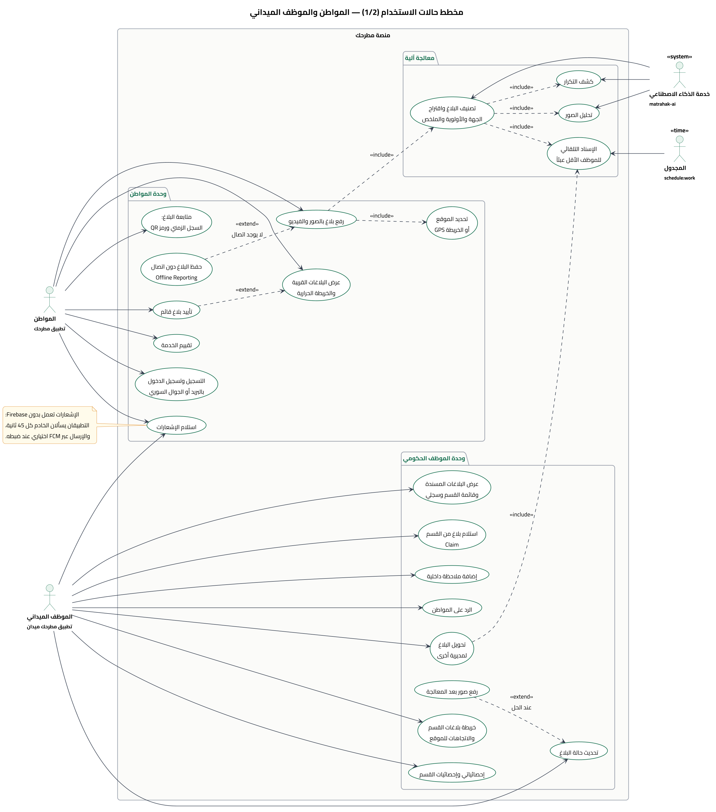

### 1.2 إدارة المدينة وإدارة النظام
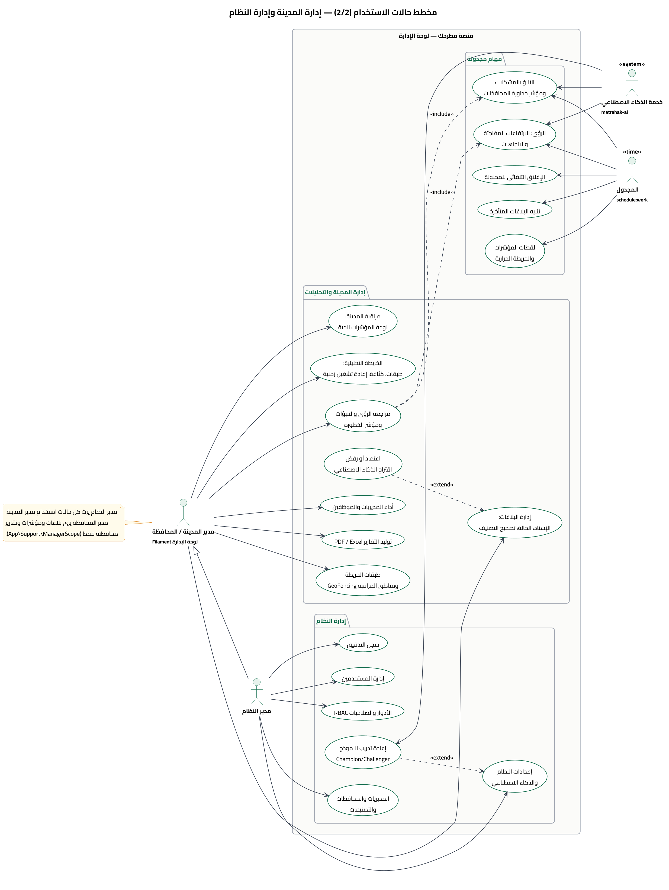

**الفاعلون (Actors):**

| الفاعل | الواجهة | الحالات الرئيسية |
|---|---|---|
| المواطن | تطبيق «مطرحك» | الرفع بالصور والفيديو والموقع، والمتابعة، والخريطة، والتأييد، والتقييم، والإشعارات |
| الموظف الميداني | تطبيق «مطرحك ميدان» | المسندة إليه وقائمة القسم، والحالة، والملاحظات، والرد، والتحويل، وإحصائيات القسم |
| مدير المدينة / المحافظة | لوحة الإدارة | المراقبة، والخريطة التحليلية، والإسناد، ومراجعة الذكاء الاصطناعي، والتقارير، والطبقات |
| مدير النظام | لوحة الإدارة | **يرث** كل ما سبق، ويضيف: المستخدمين، والأدوار والصلاحيات، والبيانات المرجعية، والإعدادات، وسجل التدقيق |
| خدمة الذكاء الاصطناعي | `matrahak-ai` | فاعل ثانوي من نوع نظام: التصنيف، والتكرار، والصور، والتنبؤ، والرؤى، وإعادة التدريب |
| المجدول | `php artisan schedule:work` | فاعل زمني: 9 مهام مجدولة |

**العلاقات المهمة:**
- `«include»`: رفع البلاغ **يتضمن** تحديد الموقع والتصنيف الآلي. والتصنيف يتضمن كشف التكرار وتحليل الصور والإسناد التلقائي.
- `«extend»`: «حفظ البلاغ دون اتصال» **يمدّ** الرفع عند انقطاع الاتصال. و«صور بعد المعالجة» تمدّ تحديث الحالة عند الحل.
- **التعميم (Generalization):** مدير النظام ← مدير المدينة.
- **مدير المحافظة** يرى بيانات محافظته فقط، عبر `App\Support\ManagerScope`.

---

## 2. مخطط الأصناف (Class Diagram)

### 2.1 نموذج المجال (Domain Model)
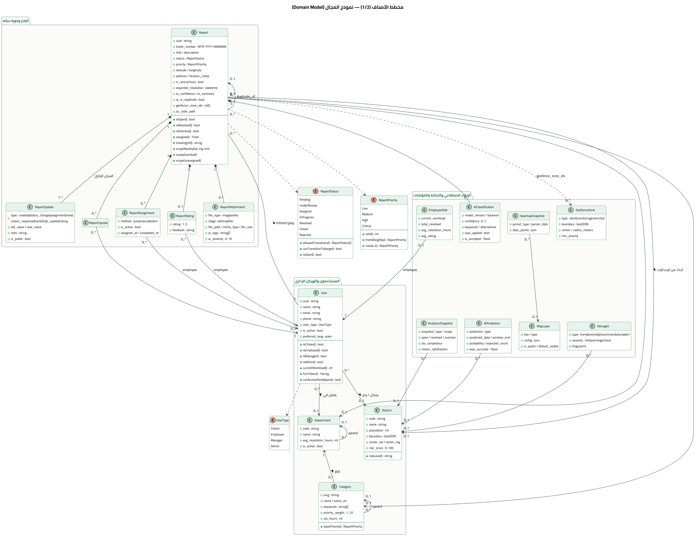

- **20 صنفاً** هي نماذج Eloquent في `app/Models`، و**3 تعدادات (Enums)** في `app/Enums`.
- **التركيب (Composition ◆):** المرفقات والسجل الزمني والإسنادات والتقييم والتأييدات **جزء من البلاغ**، وتُحذف معه (CASCADE).
- **`ReportStatus`** هو آلة الحالات نفسها، فيه `allowedTransitions()` و`canTransitionTo()`. انظر مخطط الحالات.
- **`ReportPriority::max()`** يضمن ألا تُخفَّض الأولوية آلياً أبداً.
- **`Category::basePriority()`** يحوّل وزن التصنيف (1–10) إلى أولوية أساسية.

### 2.2 طبقة الخدمات ونمط المستودع
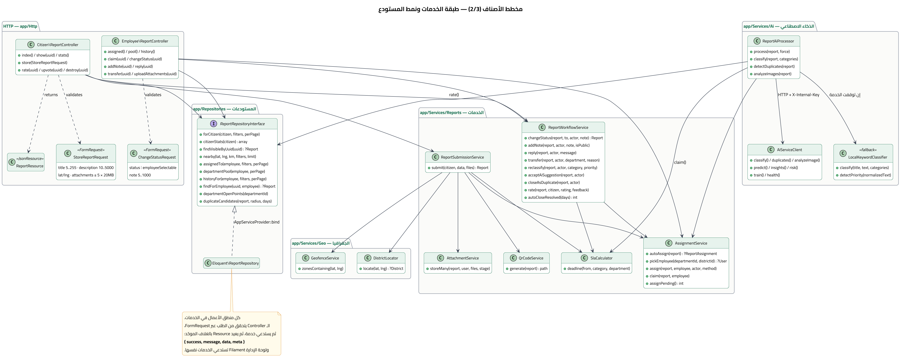

**Service Layer:**
- الـ Controller لا يحوي منطق أعمال. يتحقق من الطلب (`FormRequest`)، ثم يستدعي خدمة، ثم يعيد `JsonResource`.
- لوحة Filament تستدعي **الخدمات نفسها**، فالسلوك واحد أينما نُفّذ الإجراء: السجل الزمني، والإشعارات، والإحصائيات.

**Repository Pattern:**
- `ReportRepositoryInterface` مربوط بالتنفيذ في `AppServiceProvider`.
- يجمع الاستعلامات المعقدة كلها: القرب الجغرافي، وقوائم كل دور، ومرشّحي التكرار.

**Fallback Strategy:**
- `ReportAiProcessor` يجرّب `AiServiceClient` أولاً.
- إن فشل، يستخدم `LocalKeywordClassifier`، وهو نفس الخوارزمية بـ PHP. فالمنصة لا تتعطل إن توقفت خدمة Python.

### 2.3 الأحداث والمستمعون (Observer / Event-Driven)
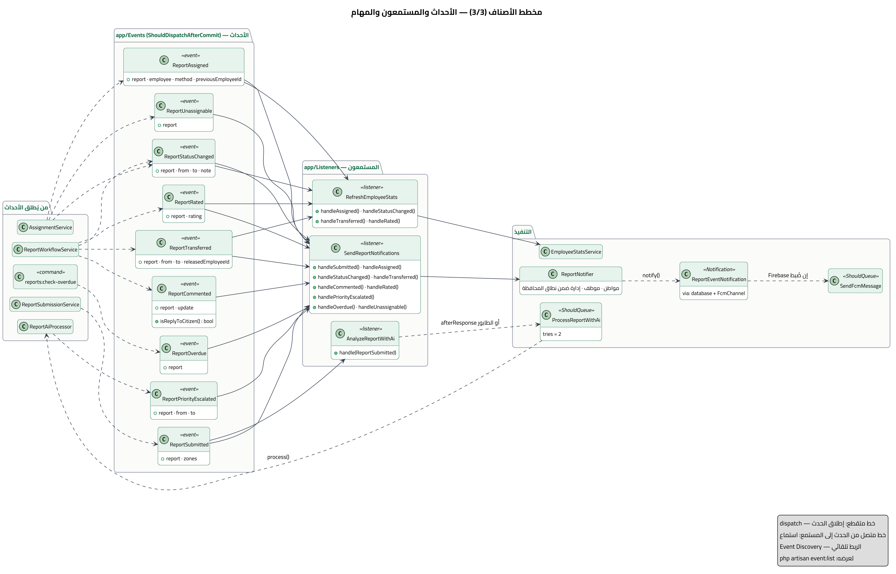

| الحدث | يُطلقه | المستمعون |
|---|---|---|
| `ReportSubmitted` | `ReportSubmissionService` | الإشعارات (مناطق المراقبة، البلاغ الحرج) · `AnalyzeReportWithAi` |
| `ReportAssigned` | `AssignmentService` | الإشعارات (الموظف) · إحصائيات الموظف الجديد والسابق |
| `ReportStatusChanged` | `ReportWorkflowService` · `AssignmentService` | الإشعارات (المواطن) · إحصائيات الموظف |
| `ReportTransferred` | `ReportWorkflowService` | الإشعارات (المواطن) · إحصائيات الموظف الذي فُكّ إسناده |
| `ReportCommented` | `ReportWorkflowService` | الإشعارات: الرد والملاحظة العامة فقط، لا الداخلية |
| `ReportRated` | `ReportWorkflowService` | الإشعارات (الموظف) · متوسط تقييمه |
| `ReportPriorityEscalated` | `ReportAiProcessor` | الإشعارات: الإدارة، إن صارت الأولوية حرجة |
| `ReportOverdue` | `reports:check-overdue` | الإشعارات: الموظف والإدارة ضمن نطاق المحافظة |
| `ReportUnassignable` | `AssignmentService` | الإشعارات: الإدارة، لا يوجد موظف فعّال في المديرية |

**ضمانات طبقة الأحداث:**
- كل حدث ينفّذ `ShouldDispatchAfterCommit`: لا يُطلق إلا بعد نجاح المعاملة، فلا إشعار عن تغيير أُلغي.
- Laravel يربط كل دالة `handleX` بحدثها تلقائياً (Event Discovery). لعرض الربط: `php artisan event:list`.

---

## 3. مخطط النشاط (Activity Diagram)

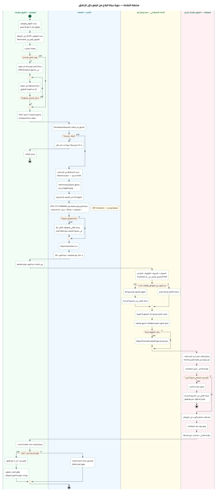

دورة البلاغ الكاملة في 4 مسارات (Swimlanes):

1. **المواطن:**
   - يملأ البلاغ ويحدد الموقع.
   - إن لم يوجد اتصال، يُحفظ البلاغ في صندوق الانتظار ويُعاد إرساله كل دقيقة.
2. **الخادم:**
   - التحقق ← تحديد المحافظة ← مناطق المراقبة ← المهلة.
   - ثم الحفظ في **معاملة واحدة** ← الإسناد إن كان التصنيف معروفاً ← حدث `ReportSubmitted` ← رد 201.
3. **الذكاء الاصطناعي، بعد الرد:**
   - التصنيف والأولوية، ثم التطبيق الآلي إن كانت الثقة كافية.
   - ثم كشف التكرار وتحليل الصور، ثم تنبيه الإدارة إن صار البلاغ حرجاً.
4. **الموظف:**
   - يستلم البلاغ ← جاري المعالجة.
   - إن كان من اختصاص مديرية أخرى: تحويل وإسناد تلقائي هناك.
   - وإلا: ملاحظات ورد، ثم صور بعد المعالجة، ثم «تم الحل».
5. **الإغلاق:** بتقييم المواطن، أو تلقائياً بعد 7 أيام (`reports:auto-close`).

---

## 4. مخطط التسلسل (Sequence Diagram)

### 4.1 رفع بلاغ وتحليله بالذكاء الاصطناعي
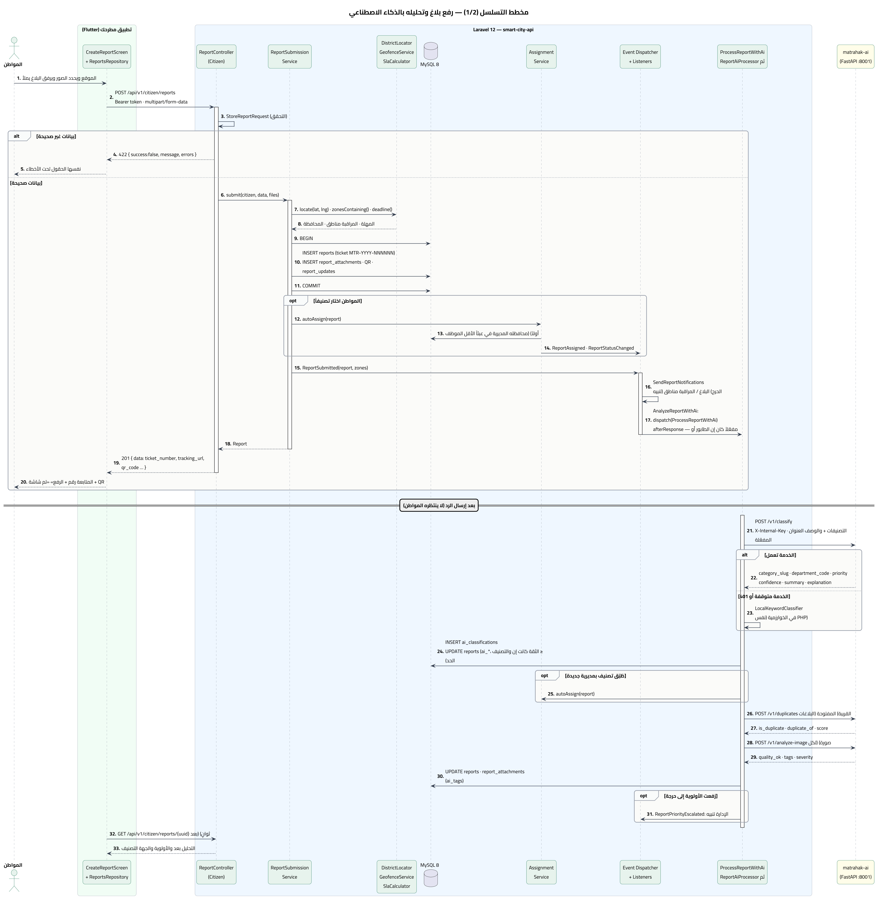

**نقطتان معماريتان:**
- **الرد للمواطن لا ينتظر الذكاء الاصطناعي** (الخطوات 1–20). التحليل بعد الرد (21–31)، والتطبيق يقرأ النتيجة بعد ثوانٍ.
- **الخدمة Stateless:** Laravel يرسل العنوان والوصف **والتصنيفات المفعّلة** في الطلب نفسه، والخدمة لا تتصل بقاعدة البيانات.
  وإن توقفت الخدمة أو رفضت المفتاح، يعمل البديل المحلي (الخطوة 23).

### 4.2 تحديث الحالة وإشعار المواطن
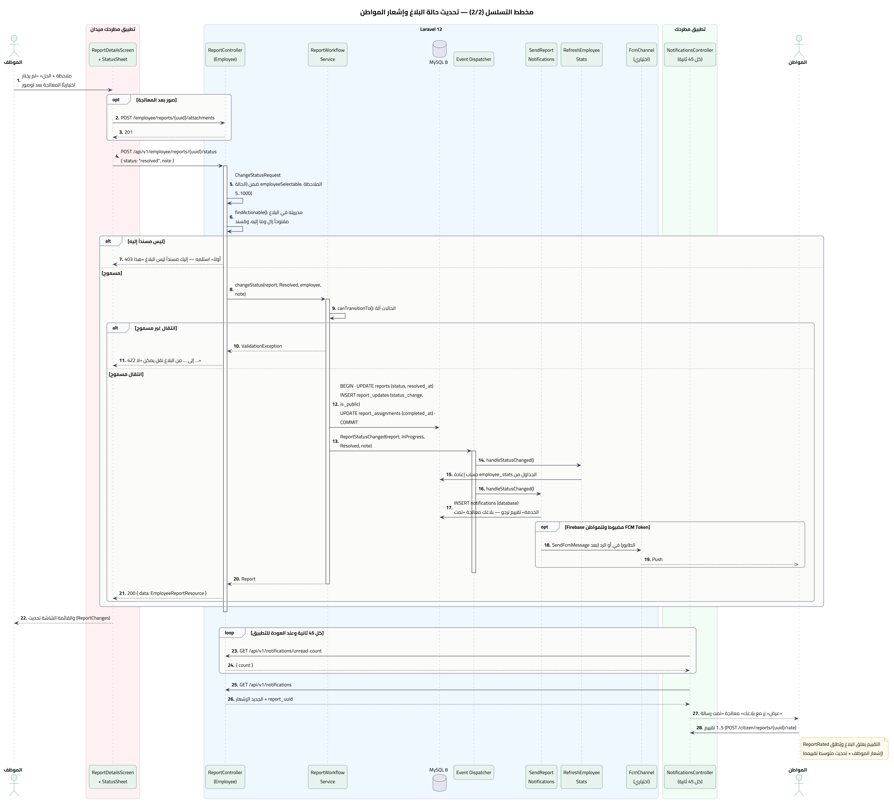

**ثلاث طبقات حماية قبل أي تغيير:**
1. `ChangeStatusRequest`: الحالة من المسموح للموظف، والملاحظة 5–1000 حرف.
2. `findActionable()`: البلاغ في مديريته، ومسند إليه هو، وما زال مفتوحاً. وإلا **403**.
3. `canTransitionTo()`: آلة الحالات. وإلا **422** برسالة عربية.

**بعد التغيير:**
- المعاملة تكتب البلاغ والسجل الزمني وإتمام الإسناد معاً.
- الحدث يحدّث إحصائيات الموظف، ويكتب إشعار قاعدة البيانات، ويرسل Push إن كان Firebase مضبوطاً.
- تطبيق المواطن يلتقط الإشعار بالاستطلاع كل 45 ثانية.

---

## 5. مخطط الحالات (State Machine Diagram)

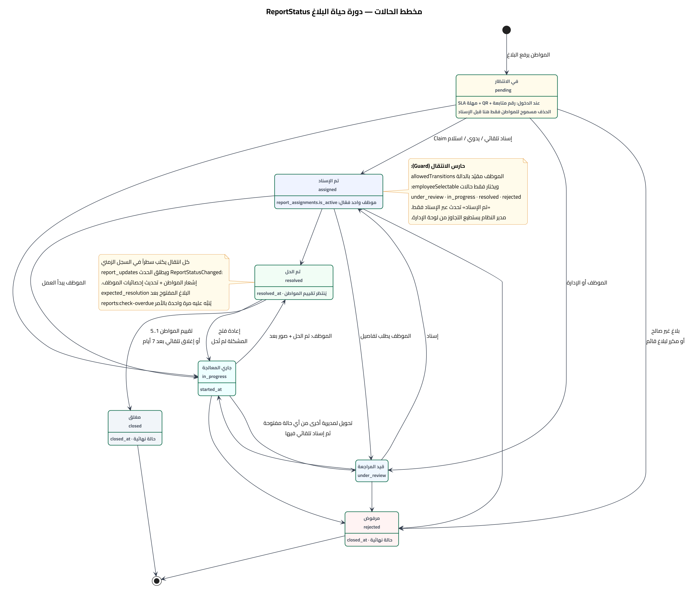

| من | إلى (مسموح للموظف) | ملاحظات |
|---|---|---|
| `pending` | `under_review` · `in_progress` · `rejected` | و`assigned` عبر الإسناد فقط |
| `under_review` | `in_progress` · `rejected` | و`assigned` عبر الإسناد |
| `assigned` | `under_review` · `in_progress` · `resolved` · `rejected` | — |
| `in_progress` | `under_review` · `resolved` · `rejected` | التحويل يعيد البلاغ إلى `under_review` من أي حالة مفتوحة |
| `resolved` | `in_progress` (إعادة فتح) · `closed` | `closed` بالتقييم أو آلياً بعد 7 أيام |
| `closed` · `rejected` | — | حالتان نهائيتان |

- المصدر: `App\Enums\ReportStatus::allowedTransitions()`.
- مدير النظام يستطيع تجاوز القيود من لوحة الإدارة (`enforceTransitions: false`)، والتجاوز يُسجَّل في سجل التدقيق.

---

## 6. مخطط النشر (Deployment Diagram)

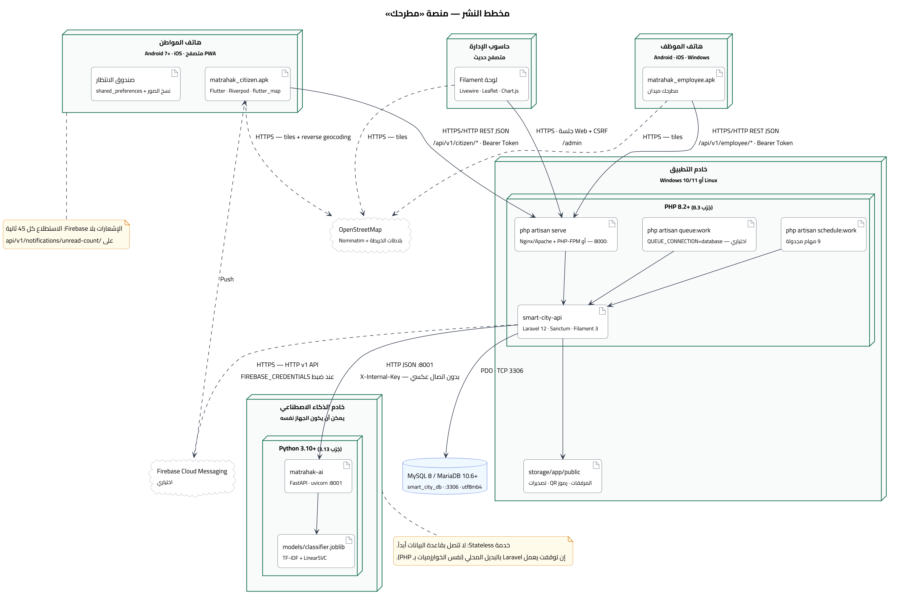

| العقدة | البرمجيات | المنفذ والبروتوكول |
|---|---|---|
| هاتف المواطن | `matrahak_citizen` (Android 7+، iOS، ويب PWA) | HTTP/HTTPS إلى `/api/v1/citizen/*` + Bearer Token |
| هاتف الموظف | `matrahak_employee` | HTTP/HTTPS إلى `/api/v1/employee/*` |
| حاسوب الإدارة | متصفح ← لوحة Filament | HTTPS، جلسة Web + CSRF |
| خادم التطبيق | PHP 8.2+، Laravel 12، والمجدول، والطابور (اختياري) | `:8000` في التطوير، وNginx/Apache في الإنتاج |
| خادم الذكاء الاصطناعي | Python 3.10+، FastAPI، uvicorn، وملف النموذج | `:8001` HTTP داخلي + `X-Internal-Key` |
| قاعدة البيانات | MySQL 8 / MariaDB 10.6+ | `:3306` |
| خارجي | OpenStreetMap (البلاطات، Nominatim)، وFCM (اختياري) | HTTPS |

- في التطوير على Windows، كل العقد الخادمة على **جهاز واحد**: Laravel وMySQL وخدمة AI.
- التطبيقان على المحاكي أو على هاتف في نفس الشبكة. التفاصيل في `02-windows-setup.md`.

---

## 7. مخطط المكوّنات (Component Diagram)

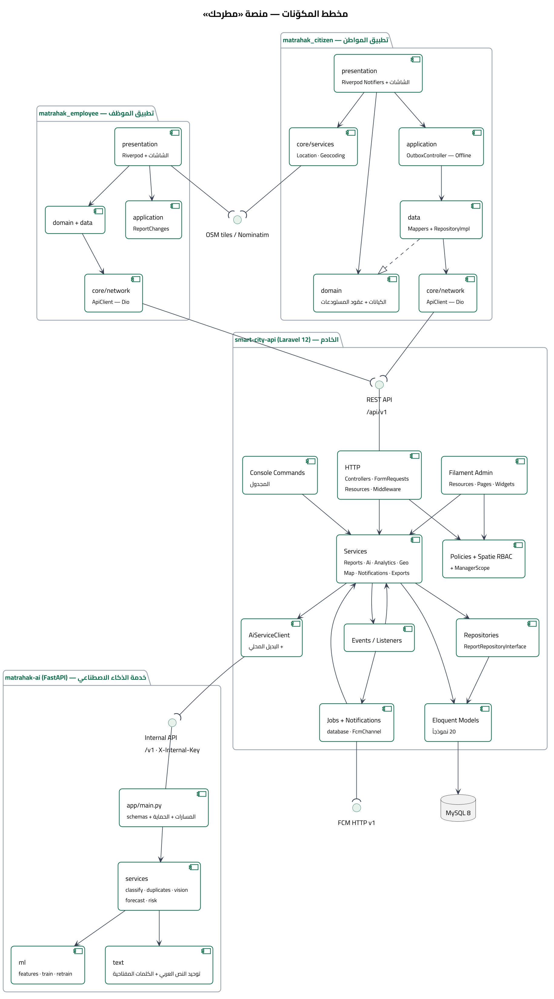

**الواجهات (Interfaces) بين الأجزاء الأربعة:**
1. **REST API `/api/v1`**: يوفّرها Laravel، ويستهلكها `ApiClient` في التطبيقين. مرجعها الكامل في `03-api-reference.md`.
2. **Internal AI API `/v1`**: توفّرها `matrahak-ai`، ويستهلكها `AiServiceClient` في Laravel فقط، بمفتاح داخلي.
3. **MySQL**: يستخدمها Laravel وحده. الخدمة والتطبيقان لا يصلون لقاعدة البيانات أبداً.
4. **OSM / Nominatim و FCM**: خدمات خارجية اختيارية؛ غيابها لا يعطّل المنصة.

---

## 8. القرارات المعمارية الرئيسية

| القرار | البديل المرفوض | السبب |
|---|---|---|
| خدمة AI مستقلة وStateless بعقد JSON | استدعاء Laravel من Python | النسخة الأصلية فعلت ذلك: 401 دائماً، وتجمّد الخادم. والفصل يسمح بتطوير النموذج ونشره وحده |
| بديل محلي لكل خوارزمية AI بـ PHP | الاعتماد الكامل على الخدمة | المنصة حكومية ويجب ألا تتوقف. التطابق مُثبت باختبارات Parity |
| Events + Listeners للآثار الجانبية | استدعاء الإشعارات من الخدمات | فصل المسؤوليات، وإضافة أثر جديد (Webhook، بث لحظي) دون تعديل الخدمات |
| الأحداث بعد نجاح المعاملة | الإطلاق فوراً | لا إشعار عن تغيير أُلغي |
| استطلاع الإشعارات مع FCM اختياري | FCM إلزامي | الإشعارات يجب أن تعمل دون حساب Firebase ودون خدمات Google |
| OpenStreetMap | Google Maps | دون مفتاح أو فوترة، ومتاح في سوريا |
| UUID في الروابط و bigint داخلياً | ID رقمي ظاهر | لا يمكن استعراض بلاغات الآخرين بتغيير رقم |
| مدير المحافظة بنطاق إجباري (`ManagerScope`) | فلاتر في الواجهة | النطاق يُفرض في الاستعلام نفسه: حتى تعديل الرابط لا يكشف محافظة أخرى (مُختبر) |

---

## 9. إعادة توليد المخططات

المتطلبات: Java 17+، و[PlantUML](https://plantuml.com/download)، وGraphviz، وخط Cairo مثبّت.

```
cd matrahak-docs\diagrams
java -DPLANTUML_LIMIT_SIZE=20000 -jar plantuml.jar -charset UTF-8 -tpng -o ..\png src\*.puml
java -DPLANTUML_LIMIT_SIZE=20000 -jar plantuml.jar -charset UTF-8 -tsvg -o ..\svg src\*.puml
```

- مخططات ERD تُولَّد آلياً من قاعدة البيانات الفعلية بأداة `tools/gen_erd.py`.
- لذلك أي ترحيل جديد يظهر فيها بإعادة تشغيل الأداة.
